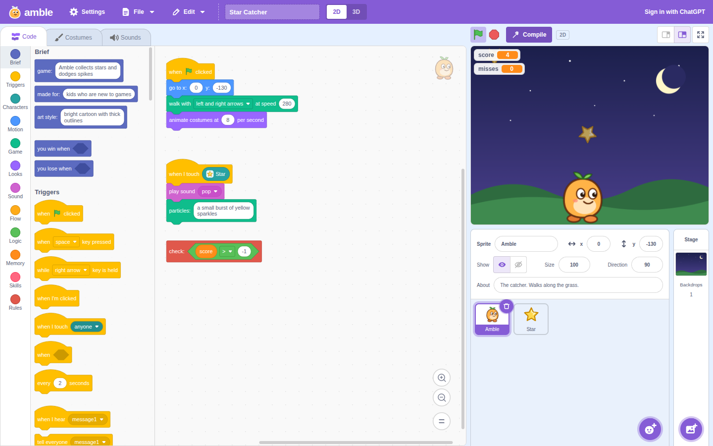

# Amble

Make real 2D games with blocks. Amble has its own block language: lots of **exact blocks** for the basics (move, walk, jump, touching, repeat, score...), and **blocks in your own words** for everything else (`do [spin around and shrink away]`, `always: [twinkle as I fall]`). Games run on [Phaser](https://phaser.io/).

**Try it:** on Vercel, with the OpenAI key set on the server, blocks in your own words build for every visitor with no account ([Deploying to Vercel](#deploying-to-vercel)). The GitHub Pages copy at https://aboufama.github.io/amble/ has no server, so there you add your own OpenAI API key in **Settings** (it stays in your browser). Running Amble on your own computer? You can **sign in with ChatGPT** instead.



- **Blocks that teach how to direct anything.** The categories follow how you'd brief a capable helper. **Brief**: say what you're making, who it's for, how it looks, and what winning means. **Characters**: name exactly who you mean, by dragging their block (with their picture) into a slot. **Rules**: say what must always or never happen, and add **checks** that tell you when something isn't true. **Skills**: break big jobs into named steps.
- **Exact where it can be, open where it should be.** Exact blocks compile instantly, offline, the same way every time. Words reach the whole game: a sentence on one sprite can change how another one plays, so when you add or change words (or the brief), the compile sees the whole program and may rewrite words elsewhere to fit, and tells you when it does. Words it didn't need to touch keep their code, and moving scripts around never recompiles anything. **Edit → Build everything again** starts over and writes everything again, so it can come out different.
- **You make the assets.** Paint costumes, upload images, record or synthesize sounds.
- **The compiler fills the gaps.** If your words need something you didn't make (the stars in "catch the falling stars", a laser sound, a crate to jump on), the compiler makes it. It shows up as a **compiled asset** with a dashed outline. Keep it to make it yours, or delete it and the next compile makes a new one. Compiled assets are reused between compiles, so your game doesn't change looks every build, until you change the **art style**: then the compiler makes its art again in the new style.

## Quick start

```bash
npm install
npm run dev            # http://localhost:5173
```

Then either:

- press **Sign in** (top right; it shows when Codex is installed). This needs the [Codex CLI](https://github.com/openai/codex) (`npm install -g @openai/codex`). Compiles then run on your ChatGPT plan with GPT-6 Astra Light, and no API key is needed ([details](#signing-in-with-chatgpt)), or
- open **Settings** and paste an OpenAI API key (stored only in your browser), or
- put `OPENAI_API_KEY=sk-...` in a `.env` file (see `.env.example`). The dev server then proxies OpenAI calls, and the key never reaches the browser (the same way the Vercel deployment does).

Press the green flag: the starter project uses only exact blocks, so it compiles instantly and needs no account. Then open one of the demos under **File → Examples**. They're written mostly in words, so the first green flag builds them (that takes a little while in Best mode), and later flags play at once:

| Demo | What the words do |
|---|---|
| **Neon Drift** | Steer a comet with the mouse through waves of asteroids. Waves, lives, the score, the golden power-up and the synthwave look are all rules in words. |
| **Lantern Cave** | A platformer in the dark. The whole level, the flickering lantern light, the bats and the 5 crystals are words; walking and jumping are exact blocks. |
| **Sky Whale** | Hold space to swim up. A sky that turns from sunset to night, parallax clouds, stars to eat and storm clouds that cost hearts. |
| **Pocket Planet** | A physics toy: click to drop cats, rocks, trees and houses onto a tiny planet whose gravity pulls toward its center. |
| **Star Catcher** | The exact-blocks one: almost everything compiles instantly, with three blocks in words. |

### Models: Best and Efficient

The switch in the menu bar picks how blocks in your own words are built:

- **Best** (the default): `gpt-6.1-terra` with high reasoning writes the code, and draws compiled art and designs sounds (at low reasoning).
- **Efficient**: `gpt-6-luna` with high reasoning, for both. About a tenth of the price of Best, and quicker. (OpenAI's newest Luna is GPT-6 Luna; there is no GPT-6.1 Luna yet. When one ships, change it in `src/compiler/models.ts`.)

Any other model your key can use can be typed in under **Settings → Advanced** (the switch then says *Custom*), and any OpenAI-compatible endpoint works via the base URL. Settings saved by earlier versions with models OpenAI is retiring (`gpt-5`, `gpt-5-mini`) move to Best when they load, and `gpt-image-1` (shut down in October 2026) becomes `gpt-image-2.5-flare`. Signed in with ChatGPT, everything uses GPT-6 Astra Light (`gpt-6-astra` with low reasoning) on your ChatGPT plan, whichever mode is picked.

### Spend (debug)

Next to the switch, a dashed **debug** chip shows what the requests from this browser have cost so far, estimated from the token usage OpenAI reports (`stream_options.include_usage`) at the standard prices in `src/compiler/spend.ts`. Click it for a breakdown by model (calls, input/cached tokens, output/reasoning tokens, cost) and a **Reset** button. It counts this browser only, not the whole OpenAI account; requests stopped partway report no usage and are listed as missing. Set `SPEND_DEBUG = false` in `src/compiler/spend.ts` to hide it.

### Signing in with ChatGPT

OpenAI only lets its own Codex app sign in with ChatGPT, not other websites. So when Amble runs on your computer, the dev server (`server/codexBridge.ts`) hands compile requests to your Codex CLI:

- **Sign in with ChatGPT** reuses the ChatGPT sign-in Codex already has, or runs `codex login`, which opens the ChatGPT sign-in page.
- Each request runs `codex exec` with GPT-6 Astra at low reasoning, the preset ChatGPT calls "Astra Light". It counts toward your ChatGPT plan's Codex usage.
- Codex runs in a read-only sandbox in an empty temporary folder, without your Codex config (`--ignore-user-config`) and without saving a session (`--ephemeral`).
- **Sign out** only stops Amble from using it; Codex stays signed in. Set `CODEX_PATH` if `codex` isn't on your PATH.

The GitHub Pages demo has no server, so there it's API keys only.

## How it works

```
 Blocks  ──►  Amble's compiler  ──────────────────────────────►  Amble engine (Phaser)
              exact blocks: engine calls, instantly               runs in a sandboxed iframe
              your words: small pieces of code, in one request
              (new words, plus any written before that must change)
```

1. **The block language** (`src/blocks/spec.ts`) defines every block once: its shape (hat, stack, C, reporter, condition, or a standalone rule), its inputs (typed numbers and words, menus, character slots, condition slots) and its help text. The editor (`src/blocks/blockly.ts`) and the compiler both read it.
2. **Exact blocks compile locally** (`src/compiler/codegen.ts`). Like Scratch, each script becomes a coroutine that its trigger starts (with Scratch's rules for restarting), loops yield once per frame, and every exact block becomes a direct engine call. The same blocks always give the same code.
3. **Words become pieces.** A block in your own words becomes a small method. Its key is a hash of what it says and where it is (the words, the block, the sprite, whether it repeats). Pieces whose key is new go out, all in one request with the whole program and the code of every piece already written (`src/compiler/prompt.ts`, strict JSON from `src/compiler/schema.ts`). Words reach the whole game, so the reply can also rewrite pieces written before, on any sprite, when the new words need them to change; a changed brief sends them to be looked at again too. The art style is a piece of its own: a rule that sets up the game's look when it starts. Pieces that don't parse get one repair round. Pieces nothing rewrote come from the last compile, and undoing an edit compiles instantly again. **Edit → Build everything again** starts over: every piece is written again and the compiled art is made again.
4. **Check and harden.** Every class is parsed with acorn (`src/compiler/transform.ts`). Loops get guards so a runaway `while (true)` pauses or stops instead of freezing the page. A missing `yield*` before `wait()` is added, and hooks that wait become coroutines.
5. **Make assets.** Compiled costumes are drawn as SVG (or by an image model, if you choose that in Settings). Sounds come from a small synthesizer (`src/audio/synth.ts`). If generation fails, a placeholder keeps the game running.
6. **Run.** The green flag builds what changed and then plays the game in an iframe with an opaque origin and a Content-Security-Policy that blocks all network access. A moment after you finish typing words, they're built quietly in the background, so the flag usually plays at once; while a block is being built it goes pale and fills back in with bricks of its own colour. With no account, blocks in your own words do nothing until they're built (adding a key or signing in builds them right away), and everything else still plays. Problems show where they happen, as a note pinned beside the block: an error or a failed **check** from the last run (with **Fix it**, which builds the words of the sprites that had problems again, with the problems attached), a block that doesn't work where it is, words that didn't build (**Try again**), and words waiting for a key or a sign-in. When words could mean quite different games, the compiler picks one and asks about it in a note on their block; the answer joins the words, and they build again. The **Problems** dialog lists everything at once.

Old projects made with earlier versions of Amble are converted to the new blocks when they're opened (`src/project/migrate.ts`), keeping every word.

### The engine

The Amble engine (`src/engine/`) is a thin, consistent game layer over Phaser 3:

- **Consistent timing.** Logic and physics run in fixed ticks: exactly 60 per second on every machine, independent of the monitor's refresh rate. `wait()`, timers and tweens use game time, not wall-clock time.
- **Unity-style sprites.** `class Player extends Sprite { start() {} update(dt) {} onKeyDown(key) {} onClick() {} onMessage(name, data) {} onCollide(other) {} onSpawn() {} }`, plus coroutines (`*start() { yield* this.wait(1) }`).
- **2D:** a 480×360 stage in pixels (Scratch coordinates), drawn at the screen's own resolution, costumes as Phaser images, a scrolling camera, layers.
- **Physics:** Matter (dynamic/static/kinematic bodies, shapes, collisions, sensors), stepped once per tick in stage units.
- **Ready-made behaviors** for the exact Game blocks: walk with the arrow keys, jump, fall with gravity (the bottom of the screen is solid), be solid ground.
- **Also:** input (keys, mouse, touch, pointer lock), Web Audio sounds, HUD text/values/buttons, speech bubbles, questions, particles.
- **At most 300 copies** (clones and spawned sprites) at once, like Scratch: a copy that makes a copy of itself stops there instead of freezing the page.
- **Full Phaser access:** compiled words can use the game's Phaser scene (`this.game.scene`), the `Phaser` namespace and each sprite's image for anything the helpers don't cover: drawing, particle emitters, post effects like glow and vignette, tweens, level geometry.

Why Phaser? It's the most established 2D game engine for the web (rendering, physics, particles, cameras, tweens, input), and the compiler knows it well, so blocks in your own words can ask for elaborate games.

## Project layout

```
src/
  blocks/      the block language (spec.ts), menus, and the Blockly editor (renderer, fields, palette)
  compiler/    code generation for exact blocks, pieces for words, prompts, schemas, OpenAI client,
               code instrumentation, compiled assets
  engine/      the game runtime that runs inside the player iframe (Phaser)
  player/      editor <-> player protocol, iframe host, run-package builder
  project/     data model, defaults and examples, migration of old projects, persistence, HTML export
  components/  React UI (blocks editor, paint editor, sounds, stage, problems, sprite pane)
api/           the server function (Vercel, and the dev server): /api/config and the guarded OpenAI proxy
server/        dev-server bridge for "Sign in with ChatGPT" (runs the Codex CLI)
dev/engine-test.html   a page for poking the engine directly (npm run dev → /dev/engine-test.html)
```

## Saving and sharing

- Projects autosave in your browser (IndexedDB).
- **File → Save to your computer** writes a `.amble` file; **Open** reads it back.
- **File → Export playable web page** produces a single `.html` file with the engine, physics and your game inside. It runs anywhere, with no server, on its own or inside another page's iframe (itch.io, a blog). Export builds what changed first, and says so instead of exporting when the build fails.

## Deploying to Vercel

Vercel runs the app and a small server function, `api/amble.ts`, that holds the OpenAI key, so blocks in your own words build for every visitor with no account and the key never reaches the browser. `vercel.json` already has everything: the Vite build, the rewrites that send `/api/config` and `/api/openai/*` to the function, a 300 s limit for long builds, and cancellation (stopping a build in the editor stops the OpenAI request too).

1. Import the repository in Vercel (**Add New → Project**). The settings come from `vercel.json`.
2. In **Project → Settings → Environment Variables**, add `OPENAI_API_KEY` with your OpenAI API key (Production, and Preview if you want preview deployments to build too). Never commit the key.
3. Deploy (or redeploy, so the variable takes effect). **Settings** in the app then says the site builds for you.
4. **Set a monthly budget** on the key's OpenAI project (platform.openai.com → Settings → Limits). The function only answers Amble's own page, but anyone can open that page.

What the function allows, so the key can only be used the way Amble uses it:

- only `chat/completions`, `images/generations` and `models`, only from Amble's own page (same origin, from a browser), only JSON;
- only the models Amble builds with: `gpt-6.1-terra` and `gpt-6-luna` (`AMBLE_MODELS`, comma-separated, to change), and `gpt-image-2.5-flare` for image art (`AMBLE_IMAGE_MODELS`); a visitor with their own key in Settings can use any model, since their requests go straight to OpenAI;
- at most 64,000 generated tokens per request (`AMBLE_MAX_OUTPUT_TOKENS`), one image per request, and only the request fields Amble sends (no `n`, `tools` or `service_tier`);
- 120 requests per visitor per 10 minutes (`AMBLE_RATE_LIMIT`; 0 turns it off). The count is kept per server instance, so it's a speed bump, not a wall: for a hard limit, add a rate-limit rule in Vercel's Firewall too.

`OPENAI_BASE_URL` points it at another OpenAI-compatible endpoint. The local dev server runs the same handler (`vite.config.ts`), without the limits: it's your own key on your own computer. To try exactly what Vercel runs, start it with `AMBLE_HOSTED=1` as well as `OPENAI_API_KEY`.

Vercel builds Production from the repository's default branch; other branches get Preview deployments, which only build words if `OPENAI_API_KEY` is also enabled for Preview.

## Deploying to GitHub Pages

`.github/workflows/pages.yml` builds the app on every push to the default branch (and `main`) and publishes `dist/` to the `gh-pages` branch, which GitHub Pages serves (Settings → Pages → Deploy from a branch → `gh-pages`, `/ (root)`). The build uses relative paths, so it works from any sub-path. On a static host there's no server key and no ChatGPT sign-in: exact blocks work for everyone, and each visitor uses their own OpenAI key from Settings to compile blocks in their own words.

## Security notes

- The API key lives in `localStorage` (or on the server with `OPENAI_API_KEY`: the dev server, or Vercel's environment variables). Compiled games can't read it: the player iframe is sandboxed without `allow-same-origin`, and its CSP blocks fetches, sockets and remote images or scripts (`default-src 'none'`, `connect-src data: blob:`). Exported pages carry the same CSP. (A CSP can't stop a page from navigating its own frame; the editor only ever sends that frame the game itself, never the key.)
- Compiled SVG art is sanitized (no scripts, event handlers, or external references) before use.
- The compile endpoints (`/api/openai`, `/api/codex`) only answer Amble's own page: they reject requests from other origins and require JSON, so other sites open in your browser can't use your key or your ChatGPT sign-in. The hosted function also limits models, tokens and request rate (see [Deploying to Vercel](#deploying-to-vercel)).

## Development

```bash
npm run typecheck
npm test                 # unit tests (vitest)
npm run test:e2e         # Playwright: the editor, instant compiles, and word compiles against a mocked API
npm run build            # production build in dist/ (includes amble-player.js)
```

To point Playwright at an already-installed Chromium, set `PW_CHROMIUM_PATH`, e.g. `PW_CHROMIUM_PATH=/path/to/chrome npm run test:e2e`.

## Ideas for next steps

- More providers (Anthropic, Gemini, local models). Everything goes through `src/compiler/openai.ts`.
- Show the compiler a picture of your costumes so compiled art matches your style even more closely.
